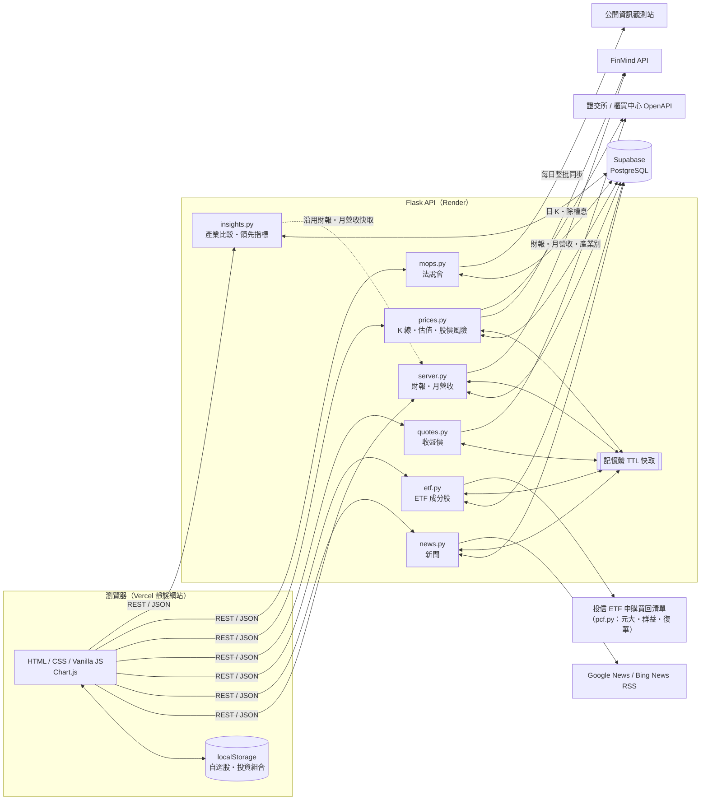

<div align="center">

# 📈 台股財報健檢儀表板

**輸入股票代號，自動檢查財報三表的警訊，並拆解 ETF 看出你真正持有哪些公司。**


[功能特色](#-功能特色) ·
[系統架構](#️-系統架構) ·
[快速開始](#-快速開始) ·
[API 文件](#-api-文件) ·
[警訊規則](#-警訊規則)

</div>

> [!WARNING]
> 本專案資料來自公開資訊（FinMind、證交所、櫃買中心、各投信公告的 ETF 申購買回清單），依財報數據自動計算，可能有延遲或誤差。所有內容僅供參考，**不構成投資建議**。

<!-- 截圖：建議放在 docs/screenshots/ 後取消註解
<p align="center">
  
  
</p>
-->

---

## ✨ 功能特色

| 頁面 | 說明 |
| --- | --- |
| **已查詢股票** `index.html` | 管理自選股，依代號或燈號嚴重程度排序；同時列出曾查詢但未加入自選的公司與 ETF，以及依查詢紀錄列出的同類型公司。 |
| **股價走勢** `prices.html` | 自選股價格總覽（盤中每 15 秒更新即時成交價，其他時間顯示收盤價）、近一月迷你走勢、52 週區間、本益比；個股日／週／月 K 線與均線，標出每季財報燈號、法說會與除權息日；本益比河流圖與還原權息報酬率比較。 |
| **警訊總覽** `alerts.html` | 彙整所有自選股觸發的警訊，可依公司分組或依嚴重程度排序，並篩選紅燈／黃燈。 |
| **個股詳情** `details.html` | 近 8 季風險分數趨勢、**獲利品質與財務體質**（ROE 與杜邦分析、F-score、M-score、Z-score、現金轉換循環）、**配息**（盈餘分配率、自由現金流涵蓋率、連續配息年數、填息天數）、**籌碼面**（三大法人、融資融券、外資持股，不計分）、**產業關鍵指標與同業排名**、**領先指標與驗證**（月營收動能、合約負債、存貨、資本支出，附歷史命中率與訊號紀錄）、五維健康度雷達圖、損益表／財務狀況表／現金流量表／月營收明細、年報與財報等官方連結、法人說明會（領先指標），以及附利多／利空標記的相關新聞；「股價與基本面」區塊把估值（本益比、股價淨值比、殖利率和自己近 5 年比較、PEG）、股價是否跟上獲利、動能、股價風險放在一起看，可點擊跳到股價走勢頁。 |
| **投資組合健檢** `portfolio.html` | 把 ETF 拆解成底層成分股並與個股持倉加總，算出真實持股比例、產業曝險、ETF 成分重疊度與集中度（HHI）。 |
| **規則與說明** `rules.html` | 列出所有警訊的判斷條件，以及各產業類型的門檻調整。 |

### 重點設計

- **同類型公司推薦**：依瀏覽器裡的查詢紀錄（自選股權重 2、其他已查詢 1）統計最常研究的產業，列出同產業、還沒查過的公司；沒有查詢紀錄時，改從查過的 ETF 成分股或其他使用者最近查詢的公司開始。興趣輪廓只在瀏覽器計算，後端只收到產業名稱。推薦只依產業類別，不依燈號或財務表現排序，並附免責聲明，可隨時關閉。點擊率與回饋只記匿名合計（`/api/recommend/stats`）。

- **29 條財報警訊規則**：涵蓋損益表、資產負債表、現金流量表，以及獲利品質（ROE 連續下滑、ROE 靠槓桿撐出來）、營運資金（現金轉換循環拉長、應付天數大增、合約負債落後營收）、地雷股（M-score、Z-score、財報延遲申報）與配息（盈餘分配率、自由現金流不足以支付股利，只檢查存股型），分為 🔴 紅燈（警戒）與 🟡 黃燈（注意）。
- **F-score 財務體質分數**：Piotroski 的 9 項檢查，顯示成「X / 9 分」；燈號抓壞訊號，F-score 是加分項目，兩者互補，不計入風險分數。
- **7 條股價與公司治理規則**：交易所變更交易方法（全額交割）、注意／處置且股價下跌、股價大幅落後大盤、波動度異常、違約距離過近、董監事質押比超過 50%、董監事持股持續減少，和財報規則一起計入燈號與風險分數。門檻依 Campbell, Hilscher & Szilagyi (2008) 破產公司的統計值與 Bharath & Shumway (2008) 的違約距離模型，採最不容易誤判的數字；股價弱勢單獨出現為黃燈，財報也有紅燈時升為紅燈。依據列在「規則與說明」頁。
- **依產業調整門檻**：依證交所產業別自動判斷公司類型（電子、景氣循環、成長、零售、營建、金融……），減少因產業特性造成的誤判；也可在個股詳情手動更改。
- **ETF 透視**：投資組合可混合輸入個股與 ETF，以矩陣乘法 `vᵀ · W` 算出每家公司的真實曝險，找出不同 ETF 重壓同一批股票的情況。
- **持股只存在本機**：自選股、投資組合與股數都存在瀏覽器 `localStorage`，不會上傳到伺服器。
- **股價資料來源**：預設只用證交所、櫃買中心 OpenAPI 的每日收盤價；盤中即時報價需取得授權後以環境變數開啟（開啟時同一檔 10 秒內所有使用者共用一次結果）。K 線歷史存在資料庫，之後每天只補新的幾天。
- **還原股價自己算**：FinMind 的還原股價需要付費，改用免費的除權息結果與股票分割資料換算調整係數；股票分割一律調整，配息可在 K 線切換是否還原。
- **淺色／深色主題**切換。

---

## 🏗️ 系統架構



### 資料流與快取策略

後端以三層快取減少外部 API 呼叫，盡量不超過 FinMind 免費帳號的額度（每小時 600 次）：

1. **記憶體快取**（`common.TTLCache`）：財報與新聞 5 分鐘、ETF 10 分鐘、收盤價 30 分鐘。
2. **Supabase**：保存 FinMind 原始資料（`raw_finmind`）與計算結果。若計算邏輯更新（`CALC_VERSION` 改變），可直接用原始資料重算，不必重新抓取。
3. **增量更新**：已有資料的股票只抓最新的部分並合併；新股票才完整抓取，且每日有上限（`FULL_FETCH_DAILY_CAP`）。

其他保護機制：

- 每個 IP 每 60 秒最多 30 次 API 請求。
- 同一檔股票以獨立的鎖（`LockRegistry`）避免同時重複抓取。
- FinMind 失敗時暫停該資料集 10 分鐘，並回傳資料庫中的舊資料（標記為 `db-stale`）。
- Supabase 連不上時（例如免費專案被暫停），改為直接向 FinMind 抓取、不讀寫資料庫（標記為 `finmind-direct`），60 秒內不再嘗試連線資料庫；批次查詢此時每批最多抓 3 檔。
- GitHub Actions（[.github/workflows/keepalive.yml](.github/workflows/keepalive.yml)）每 2 小時呼叫 `/api/health`，喚醒 Render 並查詢一次 Supabase，避免免費專案因 7 天沒有活動被暫停；Supabase 沒連上時工作會失敗，GitHub 會寄信通知。同一個工作也會觸發法說會同步。
- Render 免費方案閒置 15 分鐘會睡眠。前端每次開啟頁面會呼叫輕量的 `/api/ping`（不查資料庫、不受限流），2.5 秒內沒回應就顯示「主機正在喚醒，約需 1 分鐘」的提示，主機回應後自動收起；切換頁面時沿用原本的開始時間接續計時。頂部導覽列右側也會顯示主機狀態（檢查中／喚醒中／運作中／無法連線），點一下可重新檢查。若想完全避免等待，可用 cron-job.org 等外部排程服務每 10 分鐘呼叫 `/api/ping`。
- 法說會：公開資訊觀測站會封鎖頻繁查詢的 IP（實測 Render 連續第 2 個請求就被切斷），因此不逐檔查詢，而是整批抓「市場 × 月份」的全部法說會，且**每次只送 1 個請求、兩次至少相隔 1 小時**。順序為當月上市、當月上櫃、下月上市、下月上櫃（每天各更新一次），再補過去 12 個月（約 3 天補齊）。被封鎖時暫停 24 小時。同步只在 Render 上執行，本機只讀資料。只保存日期、摘要、簡報檔名與連結，不下載簡報。
- 資料庫用量超過上限的 85% 時，從最久沒更新的股票開始刪除，降到 75%。
- 回應附 `ETag`，資料沒變時回傳 `304 Not Modified`。

---

## 🧰 技術棧

| 層級 | 技術 |
| --- | --- |
| 前端 | HTML、CSS、Vanilla JavaScript、[Chart.js](https://www.chartjs.org/)、[Lightweight Charts](https://github.com/tradingview/lightweight-charts)（K 線） |
| 後端 | Python、Flask、Flask-CORS、Gunicorn |
| 資料庫 | [Supabase](https://supabase.com/)（PostgreSQL） |
| 資料來源 | [FinMind](https://finmindtrade.com/)（財報、月營收、股利、日 K、法人買賣、融資融券、外資持股）、[證交所 OpenAPI](https://openapi.twse.com.tw/)、[櫃買中心 OpenAPI](https://www.tpex.org.tw/openapi/)（收盤價、董監事持股餘額明細）、各投信 ETF 申購買回清單（成分股、規模、淨值）、Google News／Bing News RSS |
| 部署 | 前端 Vercel（含 Vercel Analytics），後端 Render |

---

## 📁 專案結構

```text
Financial Statements/
├── server.py          # Flask 主程式：財報、月營收、管理員 API、限流與快取
├── news.py            # 個股新聞（Google / Bing RSS）與利多／利空判斷
├── metrics.py         # 財報衍生指標：ROE／杜邦、F-score、M-score、Z-score、配息
├── insiders.py        # 董監事持股與質押（證交所、櫃買中心每月資料）
├── chips.py           # 籌碼面：三大法人、融資融券、外資持股
├── etf.py             # ETF 成分股 API（快取與資料庫）、基金規模與折溢價
├── pcf.py             # ETF 成分股來源：各投信官網的申購買回清單／每日持股（元大、群益、復華）
├── quotes.py          # 上市櫃全市場收盤價（證交所、櫃買中心）
├── mops.py            # 法人說明會（公開資訊觀測站，每日整批同步）
├── recommend.py       # 同類型公司推薦與匿名回饋統計
├── insights.py        # 產業關鍵指標與同業比較、結構化領先指標、回測與訊號紀錄
├── prices.py          # 股價：盤中即時報價、日 K 歷史、除權息／分割調整、總覽摘要
├── common.py          # 共用工具：TTLCache、LockRegistry、管理員驗證、時間處理
├── requirements.txt
│
├── index.html         # 已查詢股票
├── prices.html        # 股價走勢
├── alerts.html        # 警訊總覽
├── details.html       # 個股詳情
├── portfolio.html     # 投資組合健檢
├── rules.html         # 規則與說明
├── css/style.css
├── css/prices.css     # 股價走勢頁專用樣式
└── js/
    ├── app.js         # 共用邏輯：API 位址、自選股、主題、個股頁面
    ├── rules.js       # 警訊規則、產業類型設定、健康度評分
    ├── etf.js         # ETF 顯示與成分股
    ├── portfolio.js   # 投資組合透視計算
    ├── recommend.js   # 興趣輪廓（只在瀏覽器計算）與同類型公司推薦
    ├── prices.js      # 股價總覽、K 線、本益比河流圖、報酬率比較（Lightweight Charts）
    ├── detail-price.js # 個股詳情「股價與基本面」區塊
    ├── detail-insights.js # 個股詳情「產業與同業比較」「領先指標與驗證」區塊
    └── detail-extra.js # 個股詳情「獲利品質與財務體質」「配息」「籌碼面」區塊
```

---

## 🚀 快速開始

### 環境需求

- Python 3.10 以上
- [FinMind API Token](https://finmindtrade.com/)（免費註冊）
- [Supabase](https://supabase.com/) 專案（選用；未設定時以純記憶體模式運作，重啟後資料會消失）

### 1. 下載專案並安裝套件

```bash
git clone https://github.com/Ethan1407/Financial-Statement.git
cd Financial-Statement

python -m venv .venv
# Windows
.venv\Scripts\activate
# macOS / Linux
source .venv/bin/activate

pip install -r requirements.txt
```

### 2. 設定環境變數

在專案根目錄建立 `.env`（已列在 `.gitignore`，不會被提交）：

```env
FINMIND_TOKEN=你的_FinMind_Token
SUPABASE_URL=https://xxxx.supabase.co
SUPABASE_SERVICE_KEY=你的_Supabase_service_role_key
```

<details>
<summary>完整環境變數列表</summary>

| 變數 | 必填 | 預設值 | 說明 |
| --- | :---: | --- | --- |
| `FINMIND_TOKEN` | ✅ | — | FinMind API 金鑰 |
| `SUPABASE_URL` | | — | Supabase 專案網址；未設定則使用純記憶體模式 |
| `SUPABASE_SERVICE_KEY` | | — | Supabase service role key（只放在後端） |
| `ALLOWED_ORIGINS` | | 全部允許 | CORS 允許來源，以逗號分隔，例如 `https://your-site.vercel.app` |
| `ADMIN_KEY` | | — | 管理員 API 金鑰，透過 `X-Admin-Key` 標頭傳送 |
| `FULL_FETCH_DAILY_CAP` | | `300` | 每日新股票完整抓取上限 |
| `SUPABASE_STORAGE_LIMIT_MB` | | `500` | 資料庫容量上限（Supabase 免費方案為 500 MB） |
| `TRUSTED_PROXY_COUNT` | | `1` | 信任的反向代理層數，用於取得真實 IP |
| `CHECK_TTL_OVERRIDE_SECONDS` | | — | 覆寫「多久向 FinMind 檢查一次新資料」，測試用 |
| `FLASK_DEBUG` | | `False` | 開發模式 |
| `PORT` | | `5000` | 後端埠號 |

</details>

### 3. 啟動後端

```bash
python server.py
```

看到 `=== 環境變數狀態 ===` 後，開啟 <http://127.0.0.1:5000/api/health> 確認狀態。

### 4. 啟動前端

前端是純靜態檔案，另開一個終端機：

```bash
python -m http.server 8080
```

開啟 <http://localhost:8080>。前端在 `localhost`、`127.0.0.1` 或 `file://` 下會自動連到 `http://127.0.0.1:5000`，其他網域則連到正式環境（見 [js/app.js](js/app.js) 的 `API_BASE`）。

### Supabase 資料表

後端會用到以下資料表（以 upsert 寫入，請將主鍵設為下表欄位）：

| 資料表 | 主鍵 | 用途 |
| --- | --- | --- |
| `raw_finmind` | `stock_id`, `dataset` | FinMind 原始資料（`payload`, `fetched_at`）；法說會也存在這裡（`stock_id = 'MOPS'`，`dataset` 為 `conf:{市場}:{年-月}` 與同步狀態 `conf:state`）；領先指標的訊號紀錄（`stock_id = 'SIGNALS'`，`dataset` 為 `log:{代號}`）；股利（`dataset = 'TaiwanStockDividend'`）、籌碼（`'Chips'`）、ETF 規模與淨值（`'ETFFund'`）；董監事持股的每月全市場彙總（`stock_id = 'INSIDERS'`，`dataset` 為 `ym:{民國年月}`） |
| `stock_results` | `stock_id` | 財報計算結果（`result`, `calc_version`, `complete`, `latest_quarter`, `checked_at`, `updated_at`…） |
| `monthly_results` | `stock_id` | 月營收計算結果 |
| `stock_news` | `stock_id` | 新聞快取（`items`, `fetched_at`） |
| `etf_holdings` | `etf_id` | ETF 成分股（`holdings`, `as_of`, `fetched_at`） |

另需兩個 RPC 函式：`storage_used_bytes()` 回傳資料庫已用位元組數，`ensure_storage_capacity(max_bytes, target_bytes)` 在超過上限時刪除最舊的股票資料並回傳被刪除的代號。

---

## ☁️ 部署

**後端（Render）**

- Build Command：`pip install -r requirements.txt`
- Start Command：`gunicorn server:app`（執行緒數、逾時等設定在 [gunicorn.conf.py](gunicorn.conf.py)，gunicorn 會自動讀取：1 個 worker、8 個執行緒、逾時 120 秒）
- 盤中即時報價預設關閉，股價只用證交所、櫃買中心 OpenAPI 的每日收盤價（政府資料開放授權）。即時行情再提供給他人可能需要證交所授權，取得授權後可設定環境變數 `ENABLE_REALTIME_QUOTES=true` 開啟。
- 在 Render 設定上述環境變數，並將 `ALLOWED_ORIGINS` 設為前端網址。

**前端（Vercel）**

- 以專案根目錄部署為靜態網站，不需建置指令。
- 若後端網址不同，請修改 [js/app.js](js/app.js) 第 3 行的正式環境 API 位址。

---

## 📡 API 文件

一般 API 每個 IP 每 60 秒最多 30 次請求。

| 方法 | 路徑 | 說明 |
| --- | --- | --- |
| `GET` | `/api/health` | 服務狀態與資料庫是否連上（資料庫檢查 60 秒內共用結果）；帶 `X-Admin-Key` 才回傳 Python 版本、環境變數是否設定 |
| `GET` | `/api/stock/<stock_id>` | 個股季度財報與指標。參數：`limit`（4–24 季，預設 8）、`refresh=1`（檢查新資料，同一檔每 10 分鐘一次） |
| `GET` | `/api/stocks?ids=2330,2317` | 批次查詢，最多 20 檔 |
| `GET` | `/api/monthly/<stock_id>` | 月營收 |
| `GET` | `/api/news/<stock_id>` | 相關新聞，附利多／利空／中立標記 |
| `GET` | `/api/etf/<etf_id>` | ETF 成分股與權重；`fund` 為規模、每單位淨值、受益人數（元大、群益）、收盤價、成交量與折溢價 |
| `GET` | `/api/chips/<stock_id>` | 近 60 個交易日的三大法人買賣超、融資融券餘額、外資持股比例與摘要（每 3 小時更新，不計分） |
| `GET` | `/api/quotes?ids=0050,2330` | 最近收盤價與產業別，最多 60 檔 |
| `GET` | `/api/prices/live?ids=2330,0050` | 即時報價（盤中）或最近收盤價，最多 60 檔；回傳 `marketOpen`、建議的更新間隔 `pollSeconds` |
| `GET` | `/api/prices/history/<stock_id>` | 2019 年起的日 K（開高低收、成交張數）與除權息／分割調整係數 |
| `GET` | `/api/prices/valuation/<stock_id>` | 證交所每日本益比、股價淨值比、殖利率與近 5 年位置，12-1 個月動能、離 52 週高點、近 1 年最大回撤（與 0050 比較） |
| `GET` | `/api/prices/risk?ids=2330,2317` | 股價健康度指標：證交所／櫃買中心注意、處置、變更交易方法名單，近 3 月波動度與超額報酬（對 0050），違約距離（naive Merton DD，股數用已發行股數），最多 10 檔 |
| `GET` | `/api/prices/summary?ids=2330,0050` | 近一月收盤價（迷你走勢圖）與 52 週最高／最低，最多 10 檔 |
| `GET` | `/api/industry/<stock_id>?type=electronics&industry=半導體業` | 依公司類型的關鍵指標，與資料庫中已有財報的同產業公司比較（中位數、排名、同業最佳）；同業資料每 6 小時更新 |
| `GET` | `/api/leading/<stock_id>` | 結構化領先指標：目前的訊號、這檔與同產業合併的歷史回測（命中率、基準、平均提前月數），並把新訊號連同首次看到的日期存下來、驗證過去的紀錄 |
| `GET` | `/api/conferences/<stock_id>` | 法人說明會（過去 12 個月、當月與下個月），附同步狀態與收錄範圍 |
| `GET` | `/api/recommend/peers/<stock_id>` | 同產業公司（已有財報快取的排前面，不依財務表現排序） |
| `GET` | `/api/recommend/industries?names=半導體業,金融保險` | 依產業名稱列出公司，最多 5 個產業 |
| `GET` | `/api/recommend/popular` | 其他使用者最近查詢過的個股（新使用者冷啟動用） |
| `POST` | `/api/recommend/event` | 匿名記錄推薦的曝光、點擊、有幫助／沒幫助（只有事件類型與位置） |
| `GET` | `/api/recommend/stats?days=30` | 推薦點擊率與回饋統計 |
| `GET` `POST` | `/api/conferences/sync` | 觸發法說會同步（每次 1 個請求、至少相隔 1 小時，在背景執行；管理員加 `?force=1` 可強制） |

<details>
<summary>管理員 API（需 <code>X-Admin-Key</code> 標頭）</summary>

| 方法 | 路徑 | 說明 |
| --- | --- | --- |
| `POST` | `/api/admin/recompute/<stock_id>` | 用資料庫中的原始資料重算單一股票 |
| `POST` | `/api/admin/recompute-all` | 重算所有股票 |
| `POST` | `/api/admin/clear-cache` | 清除記憶體快取 |
| `GET` | `/api/admin/stats` | FinMind 呼叫次數、資料來源統計、資料庫用量 |
| `GET` | `/api/news-debug/<stock_id>` | 診斷新聞來源連線狀態 |

管理員呼叫 `?refresh=1` 時會強制更新，不受 10 分鐘間隔限制。

</details>

**範例**

```bash
curl "http://127.0.0.1:5000/api/stock/2330?limit=8"
curl -X POST -H "X-Admin-Key: $ADMIN_KEY" http://127.0.0.1:5000/api/admin/clear-cache
```

---

## 🚦 警訊規則

規則參考帆軟軟體〈[財務報表分析完整教學：一篇搞懂三大報表基礎與核心指標](https://www.fanruan.com/zh-tw/blog/financial-report-analysis-beginners)〉與 PTT股票公社〈[【財報三表完全解析】損益表、資產負債表、現金流量表怎麼看？新手選股第一步（2026最新）](https://pttstock.tw/financial-statements/)〉：財務比率沒有跨產業通用的安全值，應比較連續多季趨勢與去年同期。因此多數規則以「連續季數」與「去年同季」判斷。除「營業現金流低於稅後淨利」的 1 倍門檻出自文章外，其餘數字門檻為本系統的設定值，定義在 [js/rules.js](js/rules.js) 的 `RULES_CONFIG`。

<details>
<summary>完整規則列表（一般類型）</summary>

| 報表 | 警訊 | 燈號 |
| --- | --- | :---: |
| 損益表 | 營收連續衰退（連續 3 季） | 🔴 |
| 損益表 | 毛利率連續下滑（連續 3 季） | 🟡 |
| 損益表 | 毛利率單季暴跌 | 🟡 |
| 損益表 | 營收成長但毛利率下滑 | 🟡 |
| 損益表 | 營收成長但營業利益衰退 | 🟡 |
| 損益表 | 費用侵蝕本業獲利 | 🟡 |
| 損益表 | 本業與獲利背離 | 🟡 |
| 資產負債表 | 流動比率過低（< 1.0） | 🔴 |
| 資產負債表 | 速動比率偏低（< 0.8） | 🟡 |
| 資產負債表 | 負債比過高（> 70%） | 🟡 |
| 資產負債表 | 負債比持續攀升 | 🟡 |
| 資產負債表 | 應收帳款增加快於營收 | 🟡 |
| 資產負債表 | 存貨增加快於銷貨 | 🟡 |
| 資產負債表 | 利息保障倍數偏低（< 3 黃燈、< 1.5 紅燈） | 🟡／🔴 |
| 現金流量表 | 獲利含金量不足（近 8 季營業現金流 < 稅後淨利） | 🟡 |
| 現金流量表 | 淨利為正但無現金流入 | 🟡 |
| 現金流量表 | 營業現金流連續為負（連續 3 季） | 🔴 |
| 現金流量表 | 自由現金流連續為負（連續 3 季） | 🟡 |
| 現金流量表 | 靠融資撐現金 | 🔴 |

</details>

**公司類型**：一般（預設）、電子製造／半導體、傳產／景氣循環、成長股、高股息／存股型、零售／通路／服務、營建、金融業。各類型會停用不適用的規則或調整門檻，完整差異可在網站的「規則與說明」頁查看。

<details>
<summary>獲利品質、營運資金、地雷股、配息與公司治理規則</summary>

| 類別 | 警訊 | 燈號 |
| --- | --- | :---: |
| 獲利品質 | ROE 連續 3 季下降且累計少 3 個百分點以上 | 🟡 |
| 獲利品質 | ROE ≥ 15% 但權益乘數 ≥ 3 倍（營建 4 倍，金融業不檢查） | 🟡 |
| 營運資金 | 現金轉換循環連續 3 季比去年同季長，最新一季多 10 天以上 | 🟡 |
| 營運資金 | 應付帳款天數比去年同季增加 30% 且多 15 天以上 | 🟡 |
| 營運資金 | 合約負債年增率連續 2 季為負且低於營收年增率（設備、營建、工程；合約負債達單季營收 10%） | 🟡 |
| 地雷股 | Beneish M-score > −1.78 | 🟡 |
| 地雷股 | Altman Z-score 危險區（製造業 Z < 1.81，其他產業 Z'' < 1.1） | 🟡 |
| 地雷股 | 超過法定期限 10 天仍查不到該季財報 | 🟡 |
| 配息（存股型） | 盈餘分配率 > 80% 黃燈、> 100% 或虧損仍配息紅燈 | 🟡／🔴 |
| 配息（存股型） | 近 3 年自由現金流合計少於現金股利總額 | 🟡 |
| 公司治理 | 董監事質押比 > 50% | 🟡 |
| 公司治理 | 董監事持股連續 2 個月減少且累計 ≥ 3% | 🟡 |

</details>

**健康度雷達圖**：以最新一季資料，從獲利能力（毛利率、營益率、ROE）、成長性、償債能力、現金流、經營效率五個面向各給 0–100 分（設定見 `SCORE_CONFIG`）。

---

## 🗺️ 發展路線

### 分析主軸：從落後指標到領先指標

落後指標（年報、季報、月營收）用來**避開雷區**；領先指標（法說會、新聞、影音等經營面訊息）用來**提早看到變化**。領先指標和公司的基本面、所在產業與競爭力密切相關，必須先建立產業框架，才能從非結構化資料歸納出有意義的結論。因此版本順序是：先做好基本面，再做技術面輔助；先做結構化的領先指標，再做非結構化的。

| 版本 | 主題 | 內容 | 狀態 |
| --- | --- | --- | :---: |
| 1.0 | 落後指標避雷 | 29 條財報警訊規則（含 ROE、現金轉換循環、M-score、Z-score、配息）、F-score、五維健康度雷達、風險分數、白話財報摘要、ETF 透視（含規模與折溢價）與投資組合健檢 | ✅ 已完成 |
| 2.0 | 產業與競爭力框架 | 依產業類型調整門檻、各類型專屬關鍵指標（例：半導體看存貨天數與資本支出、營建看合約負債、零售看月營收）、與同產業公司比較排名（已完成）；之後可加入更細的產業數據（如稼動率、同店營收） | 🟡 大部分完成 |
| 3.0 | 領先指標萃取 | **結構化（已完成）**：月營收動能轉強／轉弱、合約負債大增／大減、存貨堆積且營收轉弱、資本支出擴張、法說會；**非結構化（規劃中）**：新聞事件萃取（目前為標題關鍵字判斷，規劃以 LLM 分析全文），最後才是 YouTube／影音 | 🟡 部分完成 |
| 4.0 | 領先↔落後關聯驗證 | 歷史回測（不用未來資料，和「沒有訊號時」的基準比較，單一公司與同產業合併）、每個訊號連同首次看到的日期存下來並自動驗證（已完成）；累積足夠紀錄後依命中率調整門檻 | 🟡 部分完成 |
| 5.0 | 投資人個人化 | 本機投資組合（已完成）、依查詢紀錄的興趣輪廓與同類型公司推薦（已完成）、問卷與風險偏好、LINE／Telegram 警訊通知 | 🟡 部分完成 |

**技術面／股價（輔助面向，已完成）**：K 線與均線、5 條股價警訊規則、籌碼面趨勢（不計分）、本益比河流圖、估值與自身歷史比較、PEG、動能與最大回撤。技術面看的是每檔股票的財務與股價變動，和基本面一起看才能取得平衡，但應建立在基本面框架之上。

> [!NOTE]
> 所有訊號都以「需要留意的變化」呈現，不給買進／賣出建議。

### 基礎建設（支撐各版本）

| 項目 | 狀態 | 為哪個版本服務 |
| --- | :---: | --- |
| 記憶體 + Supabase 雙層快取、增量更新 | ✅ | 全部：減少 FinMind 請求、提升速度與穩定性 |
| 法說會、股價、ETF 成分股的每日排程同步 | ✅ | 1.0、3.0 |
| 按時間保存的歷史資料（point-in-time）：訊號已保存首次看到的日期與數值；財報本身的歷史版本尚未保存 | 🟡 | 4.0：沒有它就無法驗證領先指標準不準 |
| 資料標準化與品質檢查：既有的品質旗標（資產負債不平、利潤率異常等）已用來排除同業比較與回測中的問題季度；重編財報偵測尚未做 | 🟡 | 2.0 同業比較、4.0 驗證 |

### 其他待辦

- [ ] 加入截圖與線上 Demo 連結
- [ ] 提供 Supabase 建表 SQL 檔
- [ ] 後端單元測試（財務指標計算、規則判斷）
- [ ] 會計師查核意見、更換會計師（目前沒有官方開放資料，觀測站封鎖程式查詢）
- [ ] ETF 總費用率與追蹤誤差（沒有官方開放資料）；復華投信的規模與淨值
- [ ] 集保大戶持股比例（FinMind 付費資料集）

---

## 🙏 致謝

- [FinMind](https://finmindtrade.com/)：台股財報、月營收與產業別資料
- [臺灣證券交易所 OpenAPI](https://openapi.twse.com.tw/)、[證券櫃檯買賣中心 OpenAPI](https://www.tpex.org.tw/openapi/)：收盤價、董監事持股餘額明細
- 元大投信、群益投信、復華投信：ETF 申購買回清單與每日持股（法規要求的公開資訊）
- [公開資訊觀測站](https://mopsov.twse.com.tw/mops/web/t100sb02_1)：法人說明會一覽表
- [Chart.js](https://www.chartjs.org/)：圖表
- [TradingView Lightweight Charts](https://github.com/tradingview/lightweight-charts)：K 線圖（Apache 2.0）
- README 結構參考 [awesome-readme](https://github.com/matiassingers/awesome-readme) 與 [Standard Readme](https://github.com/RichardLitt/standard-readme)

## 📄 授權

本專案目前尚未指定開源授權。若要開放他人使用或修改，建議加入 `LICENSE` 檔（例如 [MIT](https://choosealicense.com/licenses/mit/)）。
